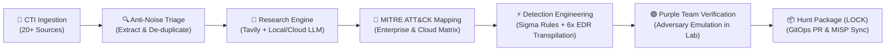

<div align="center">

# 🦉 H E C A T E

### Autonomous Threat Hunting & Detection Engineering Engine
*Turn raw adversary intelligence into validated, multi-platform detection rules in minutes.*

[](https://opensource.org/licenses/Apache-2.0)
[](https://www.python.org/downloads/)
[](https://attack.mitre.org/)
[](https://github.com/SigmaHQ/sigma)
[](https://github.com/redcanaryco/atomic-red-team)
[](https://github.com/Hecate-Org/Hecate-Public/pulls)

*“In Tenebris Venamur — In the darkness, we hunt.”*

[What is Hecate?](#-what-is-hecate) •
[Why Defenders Choose Hecate](#-why-defenders-choose-hecate) •
[How It Works](#-how-it-works) •
[How It Can Be Employed](#-how-it-can-be-employed) •
[Quick Start](#-quick-start) •
[Architecture](#-the-hecate-ecosystem)

</div>

---

## ⚡ What is Hecate?

**Hecate** is an open-source, autonomous threat hunting and detection engineering platform designed for SOCs, CIRTs, and Detection Engineering teams. 

Modern cyber defenders are inundated with hundreds of threat feeds, CVE disclosures, exploit proof-of-concepts, and CTI advisories every day. Manually researching tradecraft, drafting detection queries across multiple SIEMs, and verifying them against adversary emulation takes hours or days—leaving networks exposed during critical weaponization windows.

**Hecate automates the entire detection lifecycle:**
1. **Ingests** active adversary intelligence from 20+ OSINT and private CTI sources.
2. **Filters** commentary noise and extracts verifiable technical observables.
3. **Researches** adversary tradecraft and maps procedures to **MITRE ATT&CK®**.
4. **Drafts** vendor-neutral **Sigma** detection rules and transpiles them into native queries for **Splunk, Microsoft Defender, CrowdStrike, SentinelOne, Elastic, and Rapid7**.
5. **Validates** detection efficacy using closed-loop adversary emulation (**Atomic Red Team & MITRE CALDERA**) before a human ever touches an alert.
6. **Publishes** structured, audit-proof hunt packages following the industry-standard **LOCK** documentation framework.

```
CTI Ingestion (20+ Feeds) ──▶ Grounded Research (R-ID) ──▶ Sigma & Native Transpilation ──▶ Purple Team Emulation ──▶ Curated Hunt (H-ID)
```

---

## 🛡️ Why Defenders Choose Hecate

| Capability | Traditional Threat Hunting | With Hecate |
| :--- | :--- | :--- |
| **Response Window** | Days to weeks from exploit PoC to deployed SIEM rule | **< 5 minutes** from GitHub/CTI drop to validated multi-SIEM rule |
| **Grounding & Accuracy** | Generic LLMs hallucinate non-existent Windows event IDs | **Strict In-Source Audits**: Zero unsupported claims tolerated |
| **Platform Lock-In** | Queries hand-written for a single proprietary SIEM | **Transpiled Native Queries**: Splunk SPL, KQL, CQL, EQL, S1QL, LEQL |
| **Adversary Verification** | Assumed coverage until a red team test or breach occurs | **Automated Purple Teaming**: Detonated in sandbox against real telemetry |
| **Hunt Documentation** | Inconsistent notes in spreadsheets and ticketing queues | **LOCK Methodology**: Complete hypothesis, baseline, queries, and playbook |
| **Noise Filtering** | Analysts waste cycles on opinion blogs and non-exploits | **Intelligent Anti-Noise Triage**: Parks opinion articles; refunds draft quota |

---

## 🔄 How It Works

Hecate operates as a disciplined, multi-stage autonomous pipeline designed to ensure high fidelity and complete reproducibility:



### The Autonomous Pipeline Stages

1. **Intake & Observable Extraction:**
   Continuously monitors GitHub PoCs, CISA Advisories/KEV, AlienVault OTX, MISP, Vendor Threat Research RSS (DFIR Report, Unit 42, Mandiant, Talos), Censys C2, VulnCheck, and GTFOBins/LOLBAS. Normalizes indicators and extracts command-line syntax, target endpoints, and staging paths.

2. **Grounded Tradecraft Research:**
   Synthesizes an in-depth research dossier ([`R-####`](https://github.com/Hecate-Org/Hecate-Public/tree/main/research)). Cross-references technical blogs, patch diffs, and threat actor aliases. Enforces an automated grounding audit: every single claim, technique, and observable is strictly verified against source evidence.

3. **Multi-SIEM Detection Transpilation:**
   Writes platform-neutral Sigma rules and automatically transpiles them into battle-ready native syntax:
   - **Microsoft Sentinel / Defender for Endpoint:** Kusto Query Language (`KQL`)
   - **CrowdStrike Falcon / LogScale:** Falcon Query Language (`CQL`)
   - **Splunk Enterprise / Cloud:** Search Processing Language (`SPL`)
   - **Elastic Security:** Event Query Language (`EQL`)
   - **SentinelOne:** Deep Visibility Query Language (`S1QL`)
   - **Rapid7 InsightIDR:** Log Entry Query Language (`LEQL`)

4. **Closed-Loop Purple Team Validation:**
   Before staging detection logic, Hecate's embedded purple team engine evaluates rules against procedural adversary emulation and test sensor logs (using Linux `auditd`/eBPF or Windows Sysmon telemetry). Rules that fail detection or produce baseline false alarms are flagged or tuned automatically.

5. **LOCK Documentation & SOC Playbook:**
   Every hunt is formatted according to the **LOCK** framework:
   - **L - Learn:** Threat actor context, hypothesis statement, ABLE scoping, and verifiable source evidence.
   - **O - Observe:** Benign baseline behaviors, suspicious anomalies, and required telemetry prerequisites.
   - **C - Check:** Battle-tested Sigma rules, transpiled queries, and Atomic Red Team validation procedures.
   - **K - Keep:** Findings ledger, SOC alert triage playbooks (ADS-Lite), investigation pivot matrices, and containment steps.

---

## 🎯 How It Can Be Employed

Hecate adapts seamlessly into diverse security operations environments:

### Scenario 1: Autonomous 24/7 Threat Hunting Daemon
*Best for: Lean SOC and CIRT teams looking to scale detection engineering without burnout.*
- Deploy `hecate-runner daemon` as an unattended background service.
- Hecate monitors prioritized intelligence feeds continuously, pacing hunt creation with smart draft spacing and daily budget quotas.
- Automatically pushes ready-to-execute hunt packages to your internal Slack or Microsoft Teams channels for tier-3 analyst review.

### Scenario 2: Rapid Response & Zero-Day PoC Weaponization
*Best for: Incident Responders and Threat Intel analysts responding to breaking vulnerabilities.*
- When an active exploit PoC is dropped on GitHub or social channels, point Hecate directly at the repository or advisory:
  ```bash
  hecate-runner draft --url "https://github.com/example/cve-2026-exploits"
  ```
- In less than 3 minutes, receive a full research dossier, MITRE mapping, and copy-paste detection queries for CrowdStrike, Splunk, Sentinel, and Elastic.

### Scenario 3: GitOps Detection-as-Code Pipeline
*Best for: Modern Enterprise Detection Engineering & Platform Teams.*
- Use `hecate-runner publish` to enforce peer review and approval policies.
- Once reviewed, Hecate automatically generates pull requests to your organization's detection repository with signed promotion manifests and automated regression verification.

---

## 🚀 Quick Start

Get Hecate running in minutes. No API keys or cloud LLM accounts are required to test.

### 1. Prerequisites
- Linux or macOS (Ubuntu/Debian, RHEL, Fedora, Arch, macOS Sequoia+)
- Python 3.12 or newer
- Recommended: [`uv`](https://docs.astral.sh/uv/) for blazing-fast package management

### 2. Installation
```bash
# Clone the Core and Runner repositories
git clone https://github.com/Hecate-Org/Hecate-Core.git
git clone https://github.com/Hecate-Org/Hecate-Runner.git
git clone https://github.com/Hecate-Org/Hecate-Public.git

# Set up virtual environment
cd Hecate-Runner
uv venv .venv
source .venv/bin/activate
uv pip install -e ../Hecate-Core -e .
```

### 3. Run the Zero-Config Demonstration
Experience an end-to-end hunting cycle with bundled fixtures and mock telemetry (0 network calls, 0 LLM tokens, 100% offline):
```bash
hecate-runner demo
```
*Outputs a complete, structured hunt package with Sigma rules and verified grounding in ~3 seconds.*

### 4. Launch the Live Terminal Dashboard
Monitor pipeline activity, active step execution times, hardware telemetry (CPU, RAM, GPU, Disks), and CTI feed health in a live `htop`-style terminal interface:
```bash
hecate-agent monitor
```

---

## 🏗️ The Hecate Ecosystem

The Hecate platform is divided into specialized, decoupled components:

```
┌────────────────────────────────────────────────────────────────────────┐
│                              HECATE-ORG                                │
├──────────────────┬──────────────────┬──────────────────┬───────────────┤
│   Hecate-Core    │  Hecate-Runner   │  Hecate-Public   │    .github    │
│  ──────────────  │  ──────────────  │  ──────────────  │  ───────────  │
│  • Agent Engine  │  • Daemon Loop   │  • Hunt Catalog  │  • Org Spec   │
│  • Sigma Engine  │  • CTI Pollers   │  • Research Docs │  • Community  │
│  • ATT&CK Matrix │  • BAS Emulation │  • Sigma Rules   │  • Profile    │
│  • CLI & Monitor │  • Slack & GitOps│  • Releases      │               │
└──────────────────┴──────────────────┴──────────────────┴───────────────┘
```

- **[Hecate-Core](https://github.com/Hecate-Org/Hecate-Core):** The brain. Contains the agentic reasoning pipelines, MITRE ATT&CK provider (SQLite-indexed STIX 2.1 matrix), Sigma evaluator and multi-SIEM transpiler, and the interactive terminal monitor.
- **[Hecate-Runner](https://github.com/Hecate-Org/Hecate-Runner):** The muscle. Autonomous orchestrator service managing multi-source CTI polling, rate limiting, quota controls, Slack Socket Mode bots, and closed-loop purple team detonation.
- **[Hecate-Public](https://github.com/Hecate-Org/Hecate-Public):** The memory. The live, public catalog of version-controlled hunts, research briefings, and detection rules maintained by the community and autonomous cycles.

---

## 🤝 Contributing & Community

We believe detection engineering should be open, rigorous, and automated. We welcome contributions from defenders of all backgrounds:
- **Rule Engineers:** Submit new Sigma templates and transpiler targets.
- **Threat Researchers:** Expand CTI connectors and observable extraction parsers.
- **Purple Teamers:** Add Atomic Red Team procedures and adversary emulation abilities.

Check out our [Contributing Guidelines](https://github.com/Hecate-Org/Hecate-Public/blob/main/CONTRIBUTING.md) and join us in raising the cost for adversaries worldwide.

---

<div align="center">
  <sub>Maintained with vigilance by the <b>Hecate Organization</b>. Distributed under the Apache 2.0 License.</sub>
</div>
